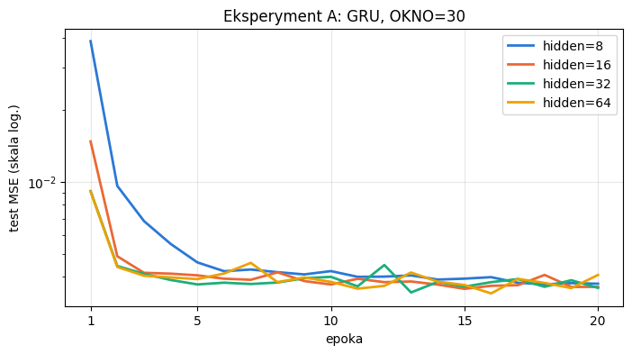
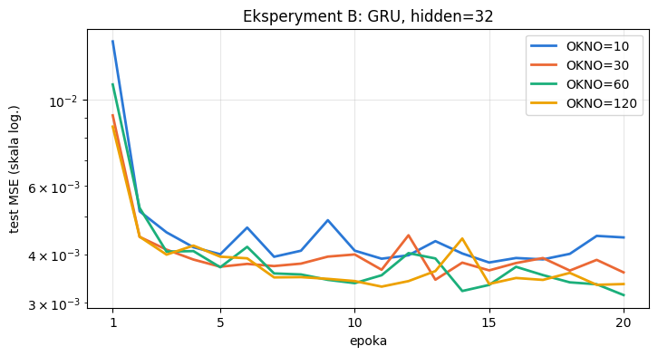
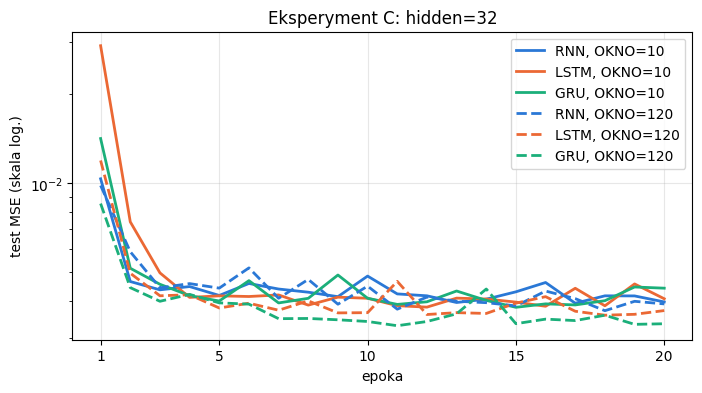
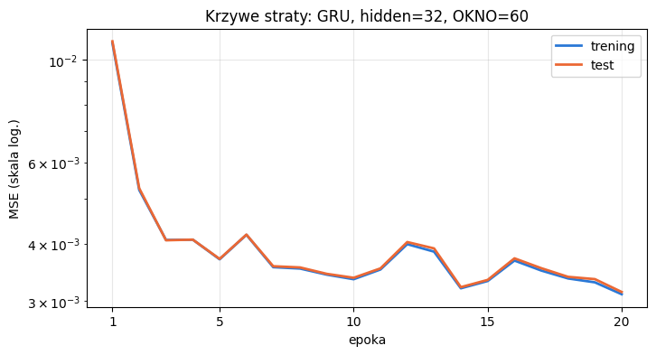
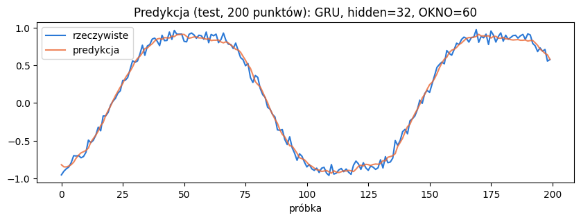

# Sprawozdanie - Laboratorium 2

**Przedmiot:** Uczenie głębokie w systemach rozpoznawania i przetwarzania mowy

**Zajęcia nr / temat:** 2 - Sieci rekurencyjne: budowa i uczenie

**Autor / grupa:** Maciej Próchniak / Gr. 3

**Data:** 22.10.2026

## 1. Cel ćwiczenia

Sprawdzenie, jak liczba jednostek ukrytych (hidden), długość okna (OKNO) i typ komórki (RNN, LSTM, GRU) wpływają na prognozę kolejnej próbki szeregu czasowego, w porównaniu z heurystyką "ostatnia próbka".

## 2. Metoda i implementacja

Użyto PyTorcha (2.11.0, CPU), NumPy, pandas i matplotlib. Dane to suma dwóch sinusoid i szumu (2000 próbek), pocięta na okna po OKNO próbek, w których celem jest następna próbka. Podział jest chronologiczny 80/20. Model to jedna warstwa rekurencyjna i warstwa liniowa na ostatnim stanie, trenowana Adamem ze stratą MSE. Funkcja trenuj zapisuje dodatkowo stratę treningową (hist_tr).

Stałe parametry: epoki=20, lr=1e-2, batch=64. Każdą konfigurację trenowano 3 razy (ziarna 0, 1, 2), a wynik to średnia i odchylenie z np.mean(hist[-5:]). Krzywe na wykresach to średnia z 3 ziaren, predykcja pochodzi z modelu z ziarnem 0, a czas w tabelach to średni czas jednego treningu.

Kod. Cały kod znajduje się w pliku `lab2_Maciej_Próchniak.ipynb` w repozytorium:

https://github.com/mprochniak1/Speech_Recognition/tree/main/Lab2

Hipotezy sformułowane przed eksperymentami:

- A: większy hidden obniży test MSE, ale coraz mniej, a różnica między 32 i 64 może mieścić się w rozrzucie między ziarnami.
- B: wydłużenie okna z 10 do 60 poprawi wynik, a przy 120 poprawa będzie niewielka albo wynik lekko się pogorszy.

## 3. Wyniki

Model bazowy (RNN, hidden=32, OKNO=30, 30 epok) osiągnął test MSE 0,00386 (średnia z 5 ostatnich epok).

### Eksperyment A - liczba jednostek (GRU, OKNO=30)

| Konfiguracja | Liczba parametrów | Test MSE (średnia ± odch.) | Czas treningu [s] |
|---|---|---|---|
| ostatnia próbka | - | 0,00631 | - |
| hidden=8 | 273 | 0,00380 ± 0,00004 | 6,2 |
| hidden=16 | 929 | 0,00374 ± 0,00002 | 6,3 |
| hidden=32 | 3393 | 0,00376 ± 0,00001 | 7,5 |
| hidden=64 | 12929 | 0,00375 ± 0,00008 | 11,1 |

### Eksperyment B - długość okna (GRU, hidden=32)

| Konfiguracja | Liczba parametrów | Test MSE (średnia ± odch.) | Czas treningu [s] |
|---|---|---|---|
| ostatnia próbka (OKNO=10-120) | - | 0,00628-0,00633 | - |
| OKNO=10 | 3393 | 0,00414 ± 0,00019 | 3,4 |
| OKNO=30 | 3393 | 0,00376 ± 0,00001 | 7,5 |
| OKNO=60 | 3393 | 0,00343 ± 0,00021 | 14,5 |
| OKNO=120 | 3393 | 0,00344 ± 0,00019 | 26,8 |

### Eksperyment C - typ komórki (hidden=32)

| Konfiguracja | Liczba parametrów | Test MSE (średnia ± odch.) | Czas treningu [s] |
|---|---|---|---|
| ostatnia próbka (OKNO=10 / 120) | - | 0,00628 / 0,00631 | - |
| RNN, OKNO=10 | 1153 | 0,00417 ± 0,00025 | 1,6 |
| LSTM, OKNO=10 | 4513 | 0,00415 ± 0,00011 | 2,8 |
| GRU, OKNO=10 | 3393 | 0,00414 ± 0,00019 | 3,4 |
| RNN, OKNO=120 | 1153 | 0,00400 ± 0,00001 | 11,4 |
| LSTM, OKNO=120 | 4513 | 0,00375 ± 0,00013 | 16,5 |
| GRU, OKNO=120 | 3393 | 0,00344 ± 0,00019 | 26,8 |

### Najlepsza konfiguracja

GRU, hidden=32, OKNO=60: test MSE 0,00343, strata treningowa 0,00339.

## 4. Analiza i interpretacja

Liczba jednostek prawie nie wpływa na wynik, różnice są rzędu odchylenia między ziarnami. Większy hidden szybciej obniża stratę w pierwszych epokach, ale dłużej się trenuje. Najwięcej daje długość okna: 10 próbek to ok. 8% okresu sygnału (ok. 126 próbek), a 60 to mniej więcej pół okresu. Przy OKNO=10 wszystkie typy komórek wypadają tak samo, a przy 120 GRU poprawia się o ok. 17%, LSTM o ok. 10%, a RNN o ok. 4%. W najlepszej konfiguracji krzywe treningowa i testowa prawie się pokrywają, a we wszystkich eksperymentach strata testowa waha się między epokami bez gwałtownych skoków i nan. Predykcja dobrze odwzorowuje sygnał i wygładza szum.

## 5. Wnioski

Większa liczba jednostek nie poprawiała wyraźnie wyniku, bo test MSE dla hidden od 8 do 64 mieściło się w zakresie 0,00374-0,00380. Najlepszy wynik dało OKNO=60 (0,00343), prawdopodobnie dlatego, że okno obejmuje ok. pół okresu i wystarcza do rozpoznania fazy sygnału, a OKNO=120 nie dało już poprawy. RNN zyskał na dłuższym oknie wyraźnie mniej niż GRU i LSTM, co może wynikać z zanikającego gradientu. Wszystkie modele były lepsze od heurystyki "ostatnia próbka" o ok. 34-46%. Przeuczenia ani niestabilności nie zaobserwowano, bo w najlepszej konfiguracji strata treningowa i testowa były bardzo zbliżone (0,00339 i 0,00343), a strata wahała się tylko lekko między epokami. Lekko opadająca na końcu krzywa najlepszej konfiguracji sugeruje możliwe niewielkie niedouczenie przy 20 epokach. Hipoteza B się potwierdziła, a A tylko częściowo, bo różnica między hidden=32 i hidden=64 mieściła się w rozrzucie, ale spadku MSE wraz z hidden praktycznie nie było. Konfigurację wybierano na zbiorze testowym, więc rzetelniej byłoby użyć osobnego zbioru walidacyjnego.
