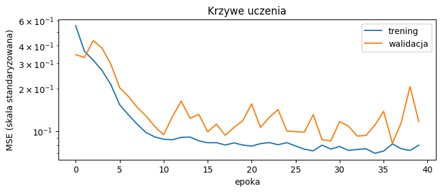
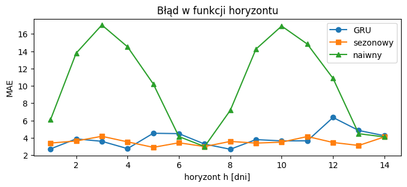

# Sprawozdanie - Laboratorium 3

**Przedmiot:** Uczenie głębokie w systemach rozpoznawania i przetwarzania mowy

**Zajęcia nr / temat:** 3 - Prognozowanie szeregów czasowych

**Autor / grupa:** Maciej Próchniak / Gr. 3

**Data:** 03.11.2026

## 1. Cel ćwiczenia

Sprawdzenie, czy model GRU prognozujący dzienną sprzedaż jest lepszy od prostych reguł (sezonowej i naiwnej) w prognozie na 1 dzień i na 14 dni oraz jak na wynik wpływa długość okna wejściowego.

## 2. Metoda i implementacja

Użyto PyTorcha (CPU), NumPy i matplotlib. Dane to syntetyczny szereg 1000 dni sprzedaży z trendem, sezonowością tygodniową i roczną oraz szumem o odchyleniu 3. Podział jest chronologiczny: trening to dni 0-699, walidacja 700-849, a test 850-999. Średnią i odchylenie do standaryzacji policzono tylko na treningu (mu = 106,96, sd = 12,00), a wszystkie metryki liczono po powrocie do oryginalnej skali.

Model to warstwa GRU z 32 jednostkami i warstwa liniowa (3393 parametry). Na wejściu dostaje 28 ostatnich dni (OKNO = 28) i przewiduje następny. Trening: Adam z lr = 1e-2, strata MSE, batch 64, 40 epok, a na końcu przywracane są wagi z epoki z najniższą stratą walidacyjną.

Prognozę na 14 dni (H = 14) liczono rekurencyjnie, wstawiając kolejne prognozy do okna, z 10 punktów startu co 14 dni w zbiorze testowym. Reguła sezonowa powtarza ostatni znany tydzień, a naiwna powtarza przez 14 dni ostatnią znaną wartość y[t0-1]. W prognozie na 1 dzień reguły to odpowiednio y[t-7] i y[t-1]. GRU i reguły oceniano na tych samych dniach i tym samym horyzoncie. W eksperymencie z oknem model trenowano od zera dla OKNO = 3, 7 i 28 z ziarnami 0 i 1, a okno wybierano według średniej straty walidacyjnej.

Kod. Cały kod znajduje się w pliku lab3_Maciej_Próchniak.ipynb w repozytorium:

https://github.com/mprochniak1/Speech_Recognition/tree/main/Lab3

## 3. Wyniki

### Krzywe uczenia

Najlepsza epoka to epoka 36 (numeracja od 0), ze stratą walidacyjną 0,0822 w skali standaryzowanej.

### GRU wobec reguł (test)

| Metoda | MAE 1 dzień | RMSE 1 dzień | MAE 14 dni | RMSE 14 dni |
|---|---|---|---|---|
| GRU | 2,91 | 3,54 | 3,88 | 4,75 |
| sezonowa | 3,21 | 4,07 | 3,52 | 4,42 |
| naiwna | 5,44 | 6,51 | 10,09 | 11,85 |
| granica szumu | 2,39 | 3,00 | - | - |

### Długość okna

| OKNO | Ziarno | Strata walidacyjna (MSE) | MAE 1 dzień | MAE 14 dni |
|---|---|---|---|---|
| 3 | 0 | 0,2567 | 5,00 | 7,18 |
| 3 | 1 | 0,2486 | 5,04 | 7,41 |
| 7 | 0 | 0,0855 | 2,90 | 4,21 |
| 7 | 1 | 0,0896 | 2,88 | 3,89 |
| 28 | 0 | 0,0822 | 2,91 | 3,88 |
| 28 | 1 | 0,0850 | 3,01 | 4,29 |

Średnia strata walidacyjna wynosi 0,253 dla OKNO = 3, 0,088 dla OKNO = 7 i 0,084 dla OKNO = 28, więc według walidacji najlepsze jest okno 28.

## 4. Analiza i interpretacja

Strata treningowa spada przez ok. 10 epok, a potem utrzymuje się na poziomie ok. 0,07-0,08. Strata walidacyjna od tego momentu waha się między ok. 0,08 a 0,2, ale nie ma trendu wzrostowego. Obie są blisko poziomu szumu w skali standaryzowanej, (3/12)² ≈ 0,0625, a różnica między nimi nie rośnie z kolejnymi epokami, więc nie widać ani niedouczenia, ani wyraźnego przeuczenia. Późna najlepsza epoka wynika raczej z wahań straty walidacyjnej, prawdopodobnie przy dość dużym lr = 1e-2, niż z dalszej poprawy modelu.

GRU wygrywa z obiema regułami w prognozie na 1 dzień (MAE 2,91 wobec 3,21 i 5,44), ale w prognozie na 14 dni przegrywa z regułą sezonową (3,88 wobec 3,52), a wygrywa tylko z naiwną (10,09). Przy jednym kroku model zawsze dostaje prawdziwe dane, a przy prognozie rekurencyjnej coraz częściej korzysta z własnych prognoz, więc błędy się kumulują. Na wykresie błąd GRU na pierwszym kroku wynosi ok. 2,7, a dalej waha się między ok. 2,7 a 4,9, ze skokiem do ok. 6,4 przy h = 12. Błąd reguły sezonowej pozostaje w zakresie ok. 2,9-4,2.

Wynik GRU na 1 dzień jest o ok. 0,52 MAE (ok. 22%) powyżej granicy szumu 2,39, więc większa część błędu to szum, którego nie da się przewidzieć. Okno 3 dni jest wyraźnie gorsze (MAE ok. 5,0), bo nie obejmuje pełnego tygodnia i model nie widzi, w którym miejscu cyklu tygodniowego się znajduje. Wydłużenie okna z 7 do 28 dni nie poprawia wyniku w wyraźny sposób.

Różnica między oknem 3 a oknami 7 i 28 jest wielokrotnie większa niż rozrzut między ziarnami. Między oknami 7 i 28 różnica średniej straty walidacyjnej (ok. 0,004) jest podobna do rozrzutu między ziarnami (0,0028-0,0041). Średnie MAE na teście różnią się o mniej niż rozrzut dla okna 28: o 0,07 na 1 dzień przy rozrzucie 0,10 i o mniej niż 0,05 na 14 dni przy rozrzucie 0,41. Wybór okna 28 nie jest więc rozstrzygający.

Obie obserwacje przenoszą się na modele mowy. Mowa po podziale na ramki co 10 ms jest szeregiem czasowym, a okno kontekstu musi obejmować całą głoskę (ok. 50-150 ms) i jej sąsiedztwo, tak jak okno sprzedaży musi obejmować tydzień. Kumulacja błędu w prognozie rekurencyjnej odpowiada dekodowaniu autoregresyjnemu w syntezie mowy krok po kroku (np. Tacotron, WaveRNN) i w dekoderze Whispera, gdzie błąd jednego kroku przenosi się na następne.

## 5. Wnioski

W tym eksperymencie GRU daje najlepszą prognozę na 1 dzień (MAE 2,91, ok. 0,5 powyżej granicy szumu), ale przy H = 14 przegrywa z regułą sezonową (3,88 wobec 3,52), prawdopodobnie przez kumulację błędu w prognozie rekurencyjnej. Krzywe uczenia nie wskazują na niedouczenie ani wyraźne przeuczenie, choć strata walidacyjna dość mocno się waha. Okno musi obejmować co najmniej jeden okres sezonowości, bo OKNO = 3 daje MAE ok. 5,0, a dalsze wydłużenie z 7 do 28 dni nie daje wyraźnej poprawy, bo różnice są porównywalne z rozrzutem między ziarnami. Przy prognozie na kilkanaście dni lepsza mogłaby być reguła sezonowa albo model przewidujący wszystkie kroki naraz. Wyniki dotyczą syntetycznego szeregu, a każde okno sprawdzono tylko na 2 ziarnach.
