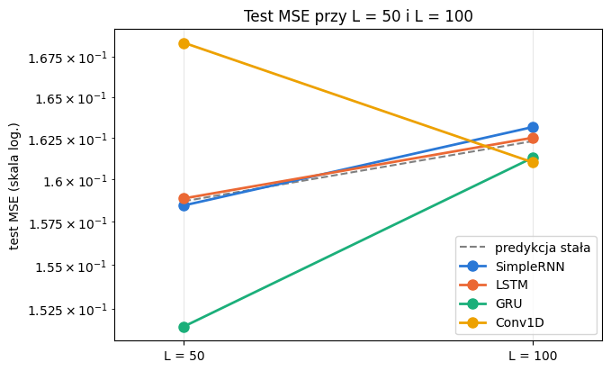

# Sprawozdanie - Laboratorium 4

**Przedmiot:** Uczenie głębokie w systemach rozpoznawania i przetwarzania mowy

**Zajęcia nr / temat:** 4 - Obsługa długich sekwencji: SimpleRNN, LSTM, GRU i Conv1D

**Autor / grupa:** Maciej Próchniak / Gr. 3

**Data:** 05.11.2026

## 1. Cel ćwiczenia

Porównanie czterech architektur (SimpleRNN, LSTM, GRU i Conv1D) w zadaniu sumowania dwóch wartości wskazywanych przez znaczniki z opóźnieniem 8 kroków oraz sprawdzenie, jak na wynik wpływają długość sekwencji, rozmiar stanu ukrytego i pole recepcyjne splotu.

## 2. Metoda i implementacja

Użyto PyTorcha 2.11.0 na CPU, NumPy i matplotlib.

Każda sekwencja ma dwa kanały: wartości losowane jednostajnie z [0, 1] i znaczniki 0 lub 1. Dwa różne znaczniki losowane są z kroków od 9 do L (numeracja od 1), a znacznik w kroku t wskazuje wartość z kroku t - 8. Celem jest suma dwóch wskazanych wartości.

Generator sprawdzono ręcznie na jednej sekwencji długości 20:

| Krok | Wartość | Znacznik |
|---|---|---|
| 1 | 0,6370 | 0 |
| 5 | 0,8133 | 0 |
| 9 | 0,5436 | 1 |
| 13 | 0,8574 | 1 |

Znaczniki są w krokach 9 i 13, więc wskazują kroki 1 i 5. Suma policzona ręcznie to 0,6370 + 0,8133 = 1,4502 i jest równa celowi z generatora (1,4502). Wartości w samych krokach ze znacznikami (0,5436 i 0,8574) nie są sumowane.

Dla L = 50 i L = 100 raz wygenerowano zbiór treningowy (4000 sekwencji) i testowy (800 sekwencji) z ziarnem 0, wspólne dla wszystkich modeli danej długości. Przed utworzeniem każdego modelu ustawiano torch.manual_seed(0).

SimpleRNN, LSTM i GRU mają jedną warstwę rekurencyjną ze stanem 32 i warstwę liniową, która liczy sumę z ostatniego stanu ukrytego. Conv1D ma 3 warstwy splotu z 32 kanałami, jądrem 3, krokiem 1, dylatacjami [1, 2, 4] i ReLU. Symetryczne dopełnienie równe dylatacji zachowuje długość sekwencji, a wynik liczony jest z mapy cech uśrednionej w czasie.

Trening dla obu długości: Adam z lr = 5e-3, strata MSE, partia 128, 30 epok, przycinanie gradientu do 1,0. Czas mierzono tylko dla pętli uczenia, w sekundach, na CPU. Ustawień nie dobierano na podstawie wyników, więc nie wydzielano walidacji, a zbiór testowy posłużył tylko do końcowej oceny.

Punkt odniesienia to stała predykcja równa średniej celu z treningu (0,9940 dla L = 50 i 0,9947 dla L = 100). Dla L = 100 wykonano dwa dodatkowe treningi na tych samych danych: SimpleRNN ze stanem 64 zamiast 32 oraz Conv1D z dylatacjami [1, 1, 1] zamiast [1, 2, 4], przy tej samej liczbie warstw i kanałów.

Kod. Cały kod znajduje się w pliku lab4_Maciej_Próchniak.ipynb w repozytorium:

https://github.com/mprochniak1/Speech_Recognition/tree/main/Lab4

## 3. Wyniki

| Model | L | Test MSE | Czas treningu [s] | Liczba parametrów |
|---|---|---|---|---|
| predykcja stała | 50 | 0,1587 | - | - |
| SimpleRNN | 50 | 0,1585 | 5,8 | 1185 |
| LSTM | 50 | 0,1589 | 9,4 | 4641 |
| GRU | 50 | 0,1515 | 15,9 | 3489 |
| Conv1D | 50 | 0,1684 | 8,5 | 6465 |
| predykcja stała | 100 | 0,1623 | - | - |
| SimpleRNN | 100 | 0,1632 | 10,9 | 1185 |
| LSTM | 100 | 0,1625 | 18,1 | 4641 |
| GRU | 100 | 0,1613 | 30,8 | 3489 |
| Conv1D | 100 | 0,1610 | 14,4 | 6465 |
| SimpleRNN, stan 64 | 100 | 0,1640 | 18,4 | 4417 |
| Conv1D, dylatacje [1, 1, 1] | 100 | 0,1609 | 13,2 | 6465 |

Pole recepcyjne pojedynczej pozycji wynosi 1 + 2 · (1 + 2 + 4) = 15 dla dylatacji [1, 2, 4] oraz 1 + 2 · (1 + 1 + 1) = 7 dla [1, 1, 1].

Przykład testowy z największym błędem dla najlepszego modelu przy L = 100 (Conv1D, test MSE 0,1610, średni błąd bezwzględny 0,3286): przykład nr 600, znaczniki w krokach 52 i 65, wskazane kroki 44 i 57, wartości 0,9432 i 0,9355, prawidłowa suma 1,8787, predykcja 0,8797, błąd bezwzględny 0,9990.

## 4. Analiza i interpretacja

Przy L = 50 lepszy od stałej predykcji jest tylko GRU (0,1515 wobec 0,1587, ok. 4,5% mniej), SimpleRNN i LSTM są na jej poziomie, a Conv1D jest o ok. 6% gorszy. Przy L = 100 wszystkie modele mieszczą się w zakresie 0,1609-0,1640, czyli praktycznie na poziomie stałej predykcji (0,1623), a GRU stracił swoją przewagę. Dłuższa sekwencja nie zmienia liczby parametrów, ale wydłużyła trening ok. 1,7-1,9 razy. Przy jednym ziarnie różnic rzędu 0,001 nie można uznać za istotne.

Większy stan SimpleRNN (64 zamiast 32) zwiększył liczbę parametrów ok. 3,7 razy i czas z 10,9 do 18,4 s bez poprawy błędu (0,1640 wobec 0,1632). Znacznik i wskazana wartość obejmują 9 kolejnych kroków, więc pole 15 przy dylatacjach [1, 2, 4] może objąć oba naraz, a pole 7 przy [1, 1, 1] nie. Obie wersje mają po 6465 parametrów i dały ten sam błąd (0,1610 i 0,1609), więc przewaga szerszego pola przy tym budżecie uczenia się nie ujawniła.

W wybranym przykładzie Conv1D przewidział 0,8797 przy prawidłowej sumie 1,8787, czyli wartość bliską średniej celu. Model prawdopodobnie nie korzysta ze znaczników i zwraca prawie stałą predykcję, na co wskazuje też średni błąd bezwzględny 0,3286, bliski 1/3 dla stałej predykcji. Przy odczycie ze średniej po 100 krokach dwa oznaczone kroki są tylko niewielką częścią tej średniej, a położenie znaczników nie ma znaczenia, w przeciwieństwie do modeli rekurencyjnych odczytujących wynik z ostatniego stanu.

## 5. Wnioski

Przy 30 epokach żaden model nie nauczył się wyraźnie korzystać z opóźnionych znaczników, bo test MSE wszystkich wariantów (0,1515-0,1684) jest blisko stałej predykcji. Tylko GRU przy L = 50 obniżył błąd o ok. 4,5%, ale przy L = 100 ta przewaga zniknęła. Większy stan SimpleRNN i dłuższa sekwencja zwiększyły koszt treningu bez poprawy błędu, a szersze pole recepcyjne Conv1D przy tym budżecie uczenia nie dało przewagi. Prawdopodobnie potrzebny byłby dłuższy trening z osobną walidacją.
