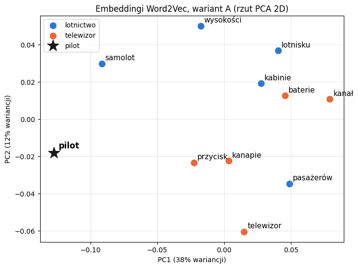

# Sprawozdanie - Laboratorium 5

**Przedmiot:** Uczenie głębokie w systemach rozpoznawania i przetwarzania mowy

**Zajęcia nr / temat:** 5 - Reprezentacje tekstu: tokenizacja BPE i embeddingi Word2Vec

**Autor / grupa:** Maciej Próchniak / Gr. 3

**Data:** 15.11.2026

## 1. Cel ćwiczenia

Sprawdzenie na własnym polskim korpusie, jak rozmiar słownika BPE wpływa na podział form fleksyjnych, jak zmiana kontekstów wyrazu o dwóch znaczeniach zmienia jego sąsiadów w Word2Vec i czy w embeddingach widać grupy tematyczne.

## 2. Metoda i implementacja

Użyto bibliotek tokenizers (BPE), gensim (Word2Vec), scikit-learn (PCA), NumPy i matplotlib.

Badany wyraz to pilot (osoba kierująca samolotem albo urządzenie do obsługi telewizora). Korpus to 60 zdań ułożonych na potrzeby ćwiczenia, w trzech pulach po 20: z pilotem samolotu, z pilotem do telewizora i bez badanego wyrazu (7 zdań o lotnictwie, 8 o telewizji i 5 na inne tematy). W zdaniach z dwóch pierwszych pul słowo pilot występuje dokładnie raz. Do BPE zdania zamieniono na małe litery, a do Word2Vec dodatkowo usunięto interpunkcję i podzielono je na słowa po spacjach.

Próbka do BPE to 8 par form widzianych i niewidzianych: samolot - samolotami, telewizor - telewizorach, lotnisku - lotniskami, kabinie - kabinami, kanał - kanałami, baterie - bateriami, przycisk - przyciskami oraz wylądował - wylądowaliśmy. Po zamianie na małe litery (ta sama normalizacja co w treningu) pierwsze formy występują w korpusie, a drugie nie.

Hipoteza zapisana przed eksperymentem: większy limit słownika zmniejszy liczbę tokenów w obu grupach, ale formy widziane staną się pojedynczymi tokenami, a niewidziane nadal będą dzielone na kilka części, więc spadek będzie u nich mniejszy.

Tokenizery BPE (token [UNK], pretokenizer Whitespace, min_frequency = 1) różnią się tylko limitem vocab_size: 100, 150 i 2000.

Word2Vec trenowano na dwóch wariantach po 36 zdań z 16 wystąpieniami słowa pilot. Wariant A to 20 zdań bez badanego wyrazu, 12 z pilotem samolotu i 4 z pilotem do telewizora, a wariant B to te same 20 zdań, 4 z pilotem samolotu i 12 z pilotem do telewizora. Ustawienia obu modeli: sg = 1, vector_size = 50, window = 3, min_count = 2, epochs = 200, seed = 0 i workers = 1, a pozostałe parametry domyślne.

Grupy wybrane przed obejrzeniem wyników to lotnictwo (samolot, lotnisku, kabinie, pasażerów, wysokości), czyli słowa związane z lotem i lotniskiem, oraz telewizor (telewizor, kanał, kanapie, baterie, przycisk), czyli słowa związane z oglądaniem telewizji i budową pilota. W wariancie A każde z tych słów występuje co najmniej 3 razy, czyli więcej niż min_count = 2.

Kod. Cały kod znajduje się w pliku lab5_Maciej_Próchniak.ipynb w repozytorium:

https://github.com/mprochniak1/Speech_Recognition/tree/main/Lab5

## 3. Wyniki

### Tokenizacja BPE

| Limit vocab_size | Faktyczny rozmiar | Śr. tokenów - widziane | Śr. tokenów - niewidziane | Formy z [UNK] - widziane | Formy z [UNK] - niewidziane |
|---|---|---|---|---|---|
| 100 | 100 | 2,88 | 5,00 | 0 | 0 |
| 150 | 150 | 1,25 | 4,25 | 0 | 0 |
| 2000 | 705 | 1,00 | 3,12 | 0 | 0 |

| Forma niewidziana | Limit 100 | Limit 150 | Limit 2000 |
|---|---|---|---|
| samolotami | samolot / a / mi | samolot / a / mi | samolot / a / mi |
| telewizorach | telewizo / ra / ch | telewizo / ra / ch | telewizora / ch |

Fragmenty w formach z korpusu: samolot (samolot, samolotu), a (np. babcia, badania, baterie), mi (np. chmurami, filmami, górami), telewizo (telewizor, telewizora), ra (np. brat, ekran, górami), ch (np. chmury, schował, silnych), telewizora (telewizora).

### Sąsiedzi słowa pilot w Word2Vec

| Miejsce | Wariant A | Cosinus | Wariant B | Cosinus |
|---|---|---|---|---|
| 1 | i | 0,884 | przycisk | 0,834 |
| 2 | samolot | 0,867 | na | 0,787 |
| 3 | na | 0,864 | nowy | 0,785 |
| 4 | przycisk | 0,816 | do | 0,782 |
| 5 | z | 0,813 | nad | 0,763 |

Model A ma 27 słów, a model B 25. Miejsce każdego z tych słów w drugim modelu:

| Słowo | Miejsce w A | Cosinus w A | Miejsce w B | Cosinus w B |
|---|---|---|---|---|
| i | 1 | 0,884 | 9 | 0,701 |
| samolot | 2 | 0,867 | 8 | 0,736 |
| na | 3 | 0,864 | 2 | 0,787 |
| przycisk | 4 | 0,816 | 1 | 0,834 |
| z | 5 | 0,813 | 13 | 0,655 |
| nowy | 14 | 0,688 | 3 | 0,785 |
| do | 9 | 0,761 | 4 | 0,782 |
| nad | 6 | 0,805 | 5 | 0,763 |

### Grupy tematyczne

| Pary słów | Liczba par | Średni cosinus |
|---|---|---|
| wewnątrz grupy lotnictwo | 10 | 0,578 |
| wewnątrz grupy telewizor | 10 | 0,515 |
| między grupami | 25 | 0,528 |

## 4. Analiza i interpretacja

Większy słownik skrócił podziały w obu grupach. Przy limicie 2000 (705 tokenów) formy widziane są pojedynczymi tokenami, a niewidziane nadal mają średnio ok. 3 tokeny. Forma samolotami przy każdym limicie dzieli się na samolot / a / mi, gdzie samolot pochodzi z form samolot i samolotu, a mi m.in. z chmurami i filmami. W formie telewizorach przy największym limicie fragmenty telewizo / ra łączą się w telewizora, czyli formę z korpusu, więc podział telewizora / ch nie pokrywa się z granicą morfemów telewizor / ach. Token [UNK] nie pojawił się, bo wszystkie znaki z próbki były w korpusie. Hipoteza potwierdziła się częściowo, bo obie grupy straciły tyle samo tokenów (ok. 1,88), a mniejszy był tylko spadek względny (ok. 38% wobec 65%).

W obu wariantach w pierwszej piątce przeważają słowa funkcyjne, np. na, które w wariancie A występuje w 16 z 36 zdań, w tym w 8 zdaniach z pilotem. W wariancie B awansowały przycisk (z 4. na 1.), nowy (z 14. na 3.) i do (z 9. na 4.), które występują w zdaniu Nowy pilot ma jeden przycisk do nagrywania, obecnym tylko w wariancie B. Słowo samolot spadło z 2. na 8. miejsce, bo z pilotem występuje w 4 zdaniach wariantu A (np. Pilot obniżył samolot nad pasem startowym) i tylko w jednym zdaniu wariantu B. Wszystkie słowa z obu piątek mają wektory w obu modelach.

Na rzucie PCA (50% wariancji) słowa z obu grup są wymieszane, a średnie cosinusy wewnątrz grup (0,578 i 0,515) są prawie takie same jak między grupami (0,528), więc grup nie widać. Przykładem jest para kabinie - baterie z różnych grup, która leży na wykresie obok siebie i ma cosinus 0,531, wyższy niż telewizor - kanał z tej samej grupy (0,368). Oba słowa często stoją obok słowa w, więc łączy je kontekst niezwiązany z tematem.

## 5. Wnioski

Większy słownik BPE skrócił podziały obu grup form (widziane z 2,88 do 1,00, niewidziane z 5,00 do 3,12 tokenu), ale nowe formy nadal są składane z fragmentów korpusu, a hipoteza potwierdziła się tylko częściowo. Zmiana proporcji zdań zmieniła ranking sąsiadów słowa pilot tylko częściowo, bo w obu wariantach przeważają częste słowa funkcyjne. Grup tematycznych nie widać ani na rzucie PCA, ani w średnich cosinusach (0,578 i 0,515 wewnątrz grup wobec 0,528 między nimi). Prawdopodobnie wynika to z bardzo małego korpusu, więc wyniki mógłby poprawić większy korpus albo usunięcie słów funkcyjnych przed treningiem.
